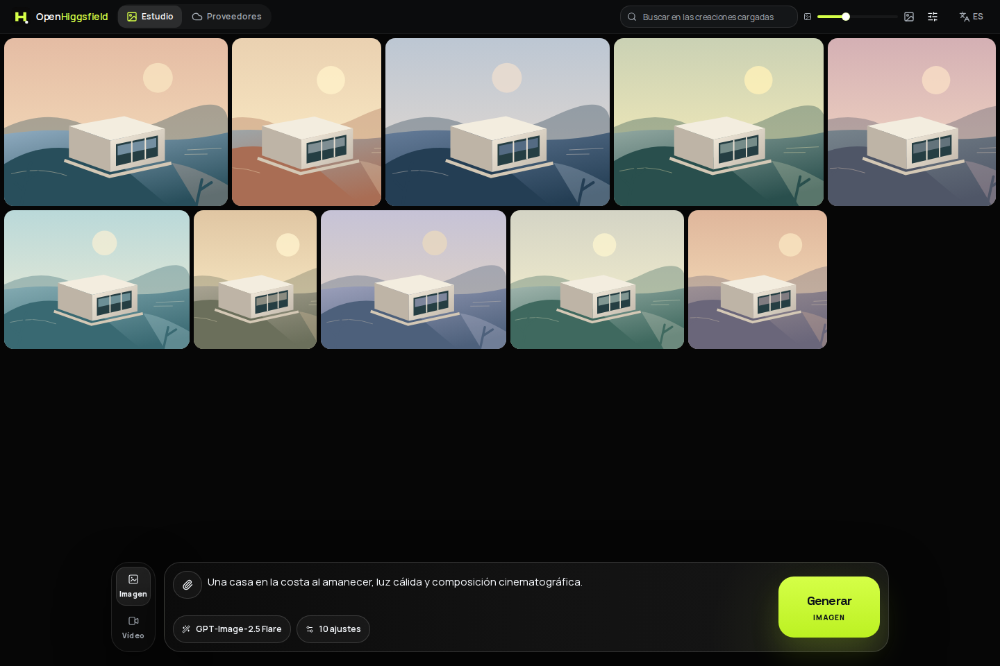
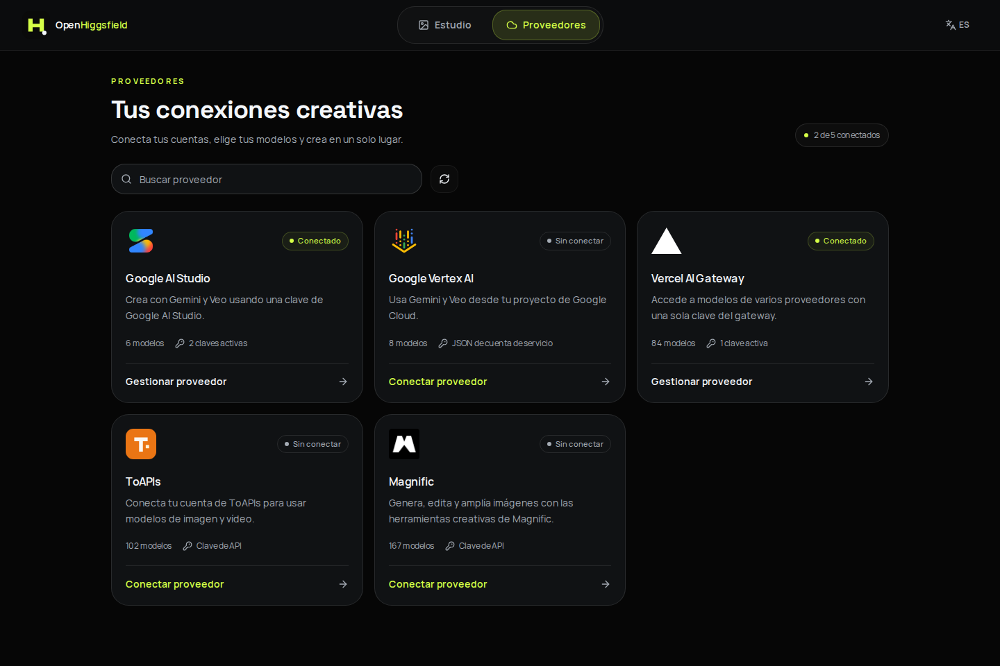
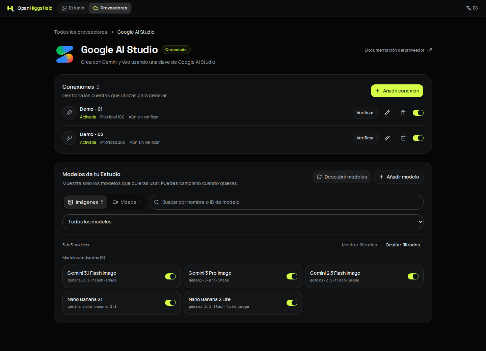
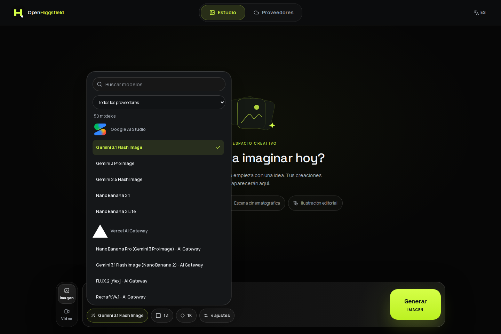
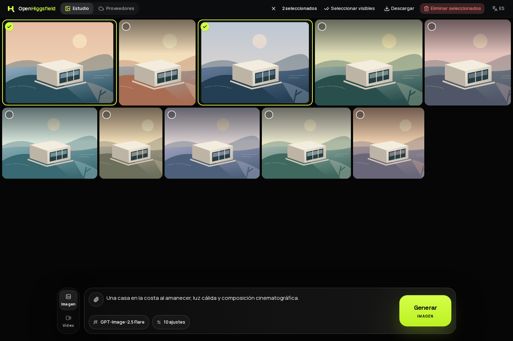
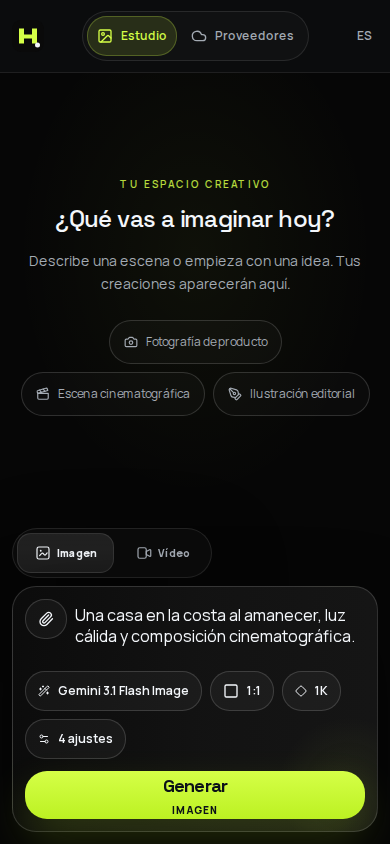
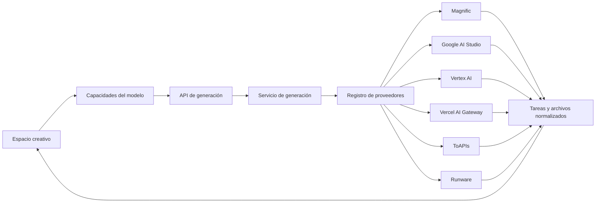

<div align="center">
  

  # Open-Higgsfield

  **La alternativa open source y multiproveedor a Higgsfield para generar imágenes y videos con IA.**

  Genera con modelos de Magnific, Google AI Studio, Google Vertex AI, Vercel AI Gateway, ToAPIs y Runware desde un único estudio creativo.

  <p>
    <a href="https://openhiggs.techbe.me"><strong>Vista previa de la interfaz</strong></a>
    |
    <a href="#por-qué-open-higgsfield">Funciones</a>
    |
    <a href="#proveedores-compatibles">Proveedores</a>
    |
    <a href="#inicio-rápido">Inicio rápido</a>
    |
    <a href="CONTRIBUTING.md">Contribuir</a>
  </p>

  <p>
    <a href="https://github.com/TechBeme/open-higgsfield/actions/workflows/ci.yml"></a>
    <a href="LICENSE"></a>
    <a href="https://nextjs.org"></a>
    <a href="https://www.typescriptlang.org"></a>
    <a href="https://github.com/TechBeme/open-higgsfield/stargazers"></a>
  </p>

  **Idiomas:** [🇺🇸 English](README.md) · [🇧🇷 Português](README.pt-BR.md) · 🇪🇸 Español

  <p>
    <a href="https://vercel.com/new/clone?repository-url=https%3A%2F%2Fgithub.com%2FTechBeme%2Fopen-higgsfield"></a>
  </p>
</div>

El sitio alojado es una vista previa de la interfaz; la generación puede estar desactivada. Para generar imágenes y vídeos, ejecuta tu propia instalación y conecta tus cuentas de proveedores.



## ¿Por qué Open-Higgsfield?

Los modelos de medios generativos están repartidos entre proveedores, paneles y controles incompatibles. Open-Higgsfield los reúne en un único espacio visual:

- **Genera imágenes y videos en el mismo estudio** sin cambiar de producto.
- **Elige modelos de imagen y vídeo** de Magnific, Google AI Studio, Vertex AI, Vercel AI Gateway, ToAPIs y Runware.
- **Usa los controles correctos para cada modelo**: aspecto, resolución, duración, seed, CFG, seguridad y audio.
- **Trabaja naturalmente con referencias** mediante image-to-image, image-to-video, fotograma inicial/final, video y audio.
- **Cambia de proveedor sin reaprender la interfaz** con tareas, progreso, errores y resultados normalizados.
- **Usa tus propias claves y controla la stack** con una aplicación Next.js MIT y autohospedable.

## Capturas de pantalla

### Gestión de proveedores

Conecta tus cuentas, activa los modelos que quieres usar y administra varias claves de API desde un solo lugar. Solo los modelos de proveedores conectados aparecen en el Estudio.



### Conexiones y selección de modelos

Cada proveedor tiene sus propias conexiones, prioridades y ajustes de visibilidad de modelos. En el Estudio, busca por nombre o ID del modelo y filtra por proveedor.

| Configuración del proveedor | Selector de modelos con búsqueda |
| --- | --- |
|  |  |

### Galería y selección

Busca y filtra tus creaciones, ajusta el tamaño de las miniaturas, amplía una vista previa, reutiliza un prompt o envía una imagen al compositor. Arrastra imágenes para reordenarlas o utiliza el menú de cada tarjeta en pantallas táctiles.

Después de seleccionar un elemento, haz clic en cualquier parte de otra imagen para seleccionarla o deseleccionarla. Arrastra desde el espacio vacío de la galería para dibujar un rectángulo de selección; con la selección activa, el gesto también puede empezar sobre una imagen. Shift/Ctrl/Cmd conserva la selección anterior durante el arrastre y Escape la borra. Descarga o elimina varios elementos a la vez.



### Estudio en escritorio y móvil

El compositor reúne el modo imagen/video, la selección de modelo, los archivos de referencia y los ajustes de cada modelo. En el móvil, el selector de modo aparece encima del compositor. La generación se ejecuta en segundo plano para que puedas iniciar otra creación mientras terminan las anteriores. Sin un proveedor conectado y un modelo habilitado, la generación permanece desactivada.

<p align="center">
  
</p>

Capturas realizadas con Playwright sobre el build de producción en un espacio aislado. Las conexiones, los prompts y las ilustraciones costeras son datos de demostración, no resultados reales de los proveedores. No se usaron claves reales, medios privados ni generaciones de pago.

## Proveedores compatibles

Conecta un proveedor desde **Proveedores** o configura sus credenciales mediante variables de entorno. El catálogo integrado contiene las siguientes entradas de imagen y video:

| Proveedor | Imágenes | Videos | Credenciales de entorno |
| --- | ---: | ---: | --- |
| Magnific | 50 | 117 | `MAGNIFIC_API_KEY` |
| Google AI Studio | 5 | 1 | `GEMINI_API_KEY` |
| Google Vertex AI | 4 | 4 | Credenciales de Google Cloud |
| Vercel AI Gateway | 45 | 39 | `AI_GATEWAY_API_KEY` |
| ToAPIs | 51 | 51 | `TOAPIS_API_KEY` |
| Runware | 191 | 110 | `RUNWARE_API_KEY` |

Recuentos verificados en `/api/catalog` el 4 de noviembre de 2026. Las entradas incluyen variantes de uso, no solo modelos distintos del proveedor. Solo los modelos habilitados de proveedores conectados aparecen en el Estudio.

El catálogo incluye Gemini Image, Veo, Flux, Recraft, GPT Image, Kling, Wan, Runway, Seedance, Seedream, PixVerse, LTX, MiniMax, Z-Image y OmniHuman. La disponibilidad, los precios, las cuotas y el acceso preview dependen de cada proveedor.

Runware incluye los 301 modelos de imagen/vídeo activos con AIR en el índice oficial (191 de imagen y 110 de vídeo), con validación de parámetros y seguimiento asíncrono. Todos están habilitados por defecto; cada instalación elige cuáles mostrar. Consulta la [integración Runware](docs/runware-models.md) para conocer la cobertura y los límites.

Consulta [Proveedores y modelos](docs/providers.md) para credenciales e instrucciones de extensión.

## Funciones

- Generación prompt-to-image y prompt-to-video
- Flujos image-to-image e image-to-video
- Referencias de fotograma inicial, final, personaje, movimiento, video y audio
- Controles de aspecto, tamaño, resolución, duración, seed, CFG, estilo y seguridad por modelo
- Audio nativo y múltiples escenas cuando están disponibles
- Entradas mediante arrastrar y soltar, pegar, subir archivos y URL pública
- Tareas síncronas y asíncronas normalizadas
- Generación en segundo plano con progreso en vivo y errores individuales por tarea
- Vistas previas con zoom, reutilización de prompts, referencias de imagen y descargas
- Galería con búsqueda, miniaturas ajustables, orden persistente, selección desde toda la tarjeta, selección rectangular y acciones en lote
- Interfaz adaptable para escritorio y móvil
- Interfaz en inglés, portugués brasileño y español, con selector de idioma persistente
- Varias conexiones cifradas por proveedor, prioridades, control de modelos visibles y descubrimiento de modelos cuando esté disponible
- Credenciales disponibles únicamente en el servidor
- Despliegue local, con Docker y en Vercel

## Stack tecnológica

[](https://nextjs.org/)
[](https://react.dev/)
[](https://www.typescriptlang.org/)
[](https://tailwindcss.com/)
[](https://vercel.com/)

- Next.js App Router y rutas de API en el servidor
- React 19, TypeScript estricto, Tailwind CSS 4 y Framer Motion
- Componentes compartidos siguiendo las convenciones de shadcn, con primitivas de Base UI
- SWR para datos en el cliente y next-intl para inglés, portugués brasileño y español
- Catálogo de capacidades y contratos de generación comunes a los proveedores
- Magnific API, Google Gen AI SDK, Vertex AI, Vercel AI Gateway, ToAPIs y Runware
- Medios privados en Vercel Blob/S3 y URLs de referencia firmadas; compatibilidad con Cloudinary heredado
- Historial en PostgreSQL/Neon o almacenamiento local explícito con un solo proceso

## Arquitectura



La interfaz lee las capacidades de los modelos. El backend convierte cada solicitud en parámetros canónicos, resuelve el adaptador y normaliza resultados síncronos u operaciones asíncronas en el mismo formato de tarea. Consulta [Arquitectura](docs/architecture.md).

## Inicio rápido

### Requisitos previos

- Node.js 22.23.4 o más reciente dentro de la línea Node 22
- npm 10+
- Credenciales de al menos un proveedor
- Para instalaciones distribuidas: credenciales de Vercel Blob o S3 para medios y referencias persistentes; Cloudinary heredado es opcional

### 1. Clona e instala

```bash
git clone https://github.com/TechBeme/open-higgsfield.git
cd open-higgsfield
npm ci
```

### 2. Configura el cifrado de conexiones

```bash
cp .env.example .env.local
node -e "console.log(require('node:crypto').randomBytes(32).toString('hex'))"
```

Copia el valor generado en `.env.local`:

```dotenv
PROVIDER_CONFIG_ENCRYPTION_KEY=<pega-el-valor-generado>
```

Esta clave cifra las credenciales guardadas desde la interfaz. Mantén el mismo valor entre reinicios y conserva una copia de seguridad separada de la configuración; cambiarlo impide descifrar las conexiones existentes. No subas `.env.local` a Git.

### 3. Inicia y conecta un proveedor

```bash
npm run dev
```

Abre [http://localhost:3000](http://localhost:3000). Usa el selector de la barra superior para cambiar entre inglés, portugués y español.

1. Abre **Proveedores**, selecciona un proveedor y pulsa **Añadir conexión**.
2. Introduce un nombre y la clave de API, o los datos de la cuenta de servicio de Vertex AI. Puedes añadir varias conexiones y definir sus prioridades.
3. Elige los modelos de imagen y video que quieres mostrar, vuelve al **Estudio** y escribe un prompt. Sin una conexión y un modelo habilitados, la generación permanece desactivada.

**Descubrir modelos** está disponible para Google AI Studio, Vercel AI Gateway y Runware. El descubrimiento guarda candidatos para revisión; no los activa automáticamente. Los modelos personalizados reutilizan un adaptador compatible y necesitan un contrato de capacidades revisado. Consulta [configuración de proveedores](docs/providers.md#runtime-provider-configuration).

El desarrollo escucha en `127.0.0.1`. Sin credenciales, mantén el servidor local; configura una contraseña y un origen HTTPS antes de exponer otro entorno.

### Credenciales de entorno (opcional)

Para instalaciones gestionadas mediante variables de entorno, configura en `.env.local` solo los proveedores que quieras usar:

```dotenv
MAGNIFIC_API_KEY=
GEMINI_API_KEY=
GOOGLE_CLOUD_PROJECT=
GOOGLE_CLOUD_LOCATION=global
GOOGLE_SERVICE_ACCOUNT_JSON=
AI_GATEWAY_API_KEY=
TOAPIS_API_KEY=
RUNWARE_API_KEY=

# Medios y referencias persistentes (Blob privado)
# ASSET_STORAGE_MODE=vercel-blob
# ASSET_DELIVERY_MODE=private
# BLOB_READ_WRITE_TOKEN=
```

Nunca uses `NEXT_PUBLIC_` para credenciales de proveedores. Solo se leen en el servidor.

Las conexiones guardadas tienen prioridad sobre las credenciales de entorno. Si desactivas todas las conexiones guardadas de un proveedor, sus modelos desaparecen del Estudio aunque exista una clave en el entorno.

### Docker

Reutiliza el archivo `.env.local` ya configurado y completa la configuración de producción antes de iniciar el contenedor.

```bash
docker compose up --build
```

Configura el acceso de producción y el perfil de proceso único en la [guía de operación](docs/production.md) antes de iniciar Docker. Los archivos y el historial se guardan en el volumen `open-higgsfield-data`; el puerto 3000 se publica solo en loopback para un proxy inverso HTTPS.

## Despliegue en Vercel

Producción requiere una credencial del operador, origen HTTPS, PostgreSQL migrado, medios persistentes en Vercel Blob o S3 y **Vercel Workflows** para enviar, observar y almacenar generaciones en segundo plano. No se necesita cron por minuto ni programación en GitHub. Consulta [ejecución en segundo plano](docs/background-execution.md) para conocer la configuración y los costes de uso. Las nuevas generaciones quedan desactivadas hasta configurar `GENERATION_ENABLED=true`.

Cada despliegue es un espacio BYOK de un operador: quien tiene la credencial accede a todas las tareas y utiliza las mismas cuentas de proveedores. No hay aislamiento por usuario, presupuesto monetario ni límite global de solicitudes en la aplicación. Configura cuotas de proveedores y protección de entrada. Los originales en Blob/S3 son privados por defecto, con enlaces temporales para visualización y referencias de proveedores. Consulta la [guía de almacenamiento](docs/storage.md).

Sigue la [guía de operación](docs/production.md) antes de iniciar Docker o publicar en Vercel; describe configuración, migración, HTTPS, verificación del Workflow y recuperación.

Para actualizar un despliegue existente, consulta el [checklist de Vercel](docs/deployment.md#updating-an-existing-vercel-deployment): integración Git, variables, migraciones y verificación. Esta actualización requiere la migración `0003_workflow_queue.sql` y el perfil de ejecución Workflow; sigue el checklist antes de publicar.

## Comandos

| Comando | Propósito |
| --- | --- |
| `npm run dev` | Inicia el servidor de desarrollo |
| `npm run lint` | Ejecuta ESLint |
| `npm run typecheck` | Comprueba TypeScript |
| `npm test` | Ejecuta pruebas unitarias y de integración |
| `npm run test:e2e` | Ejecuta pruebas aisladas de navegador y accesibilidad |
| `npm run build` | Crea el build de producción |
| `npm run check` | Ejecuta auditoría, lint, typecheck, pruebas, build y pruebas de navegador |
| `npm start` | Sirve el build de producción |

Configuración y aislamiento de las pruebas de navegador: [Verificación](docs/architecture.md#verification).

## Documentación

- [Proveedores y modelos](docs/providers.md)
- [Arquitectura](docs/architecture.md)
- [Despliegue](docs/deployment.md)
- [Cómo contribuir](CONTRIBUTING.md)
- [Política de seguridad](SECURITY.md)

## Cómo contribuir

Lee [CONTRIBUTING.md](CONTRIBUTING.md), crea una rama enfocada, ejecuta `npm run check` y abre un pull request. Si el proyecto te resulta útil, **dale una estrella al repositorio** y comparte lo que construyes.

## Seguridad y aviso legal

No informes vulnerabilidades en issues públicas. Open-Higgsfield es independiente y no está afiliado a Higgsfield AI, Magnific, Google, Vercel ni proveedores de modelos. Eres responsable de los costes, el contenido generado, la seguridad y el cumplimiento legal.

## Licencia

Publicado bajo la [Licencia MIT](LICENSE).

---

<div align="center">

**Developed by [Rafael Vieira](https://github.com/TechBeme)**

[](https://github.com/TechBeme)
[](https://www.fiverr.com/tech_be)
[](https://www.upwork.com/freelancers/~01f0abcf70bbd95376)
[](mailto:contact@techbe.me)

</div>
