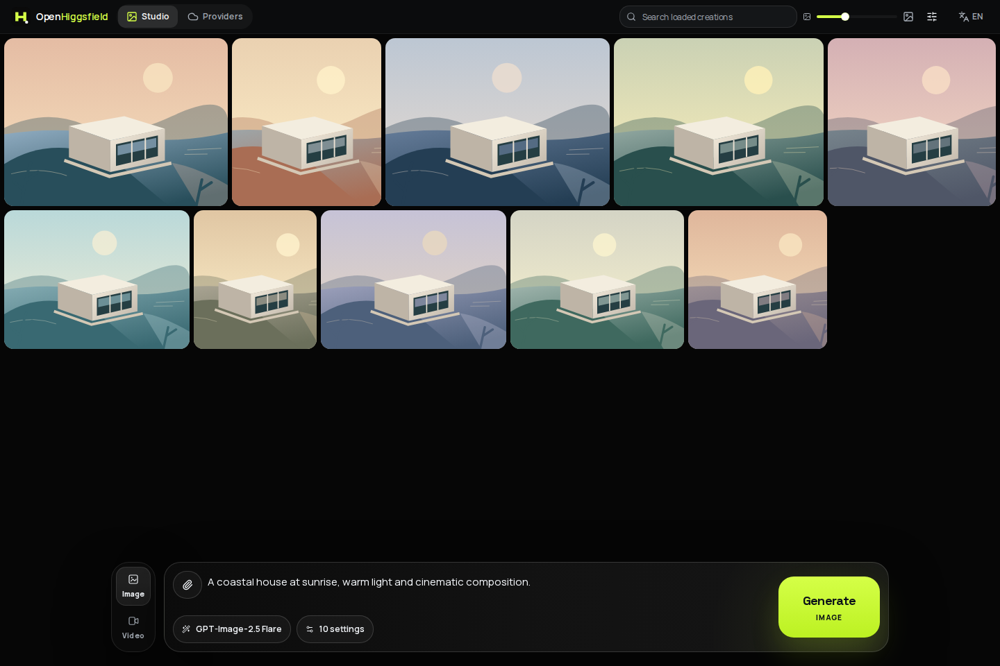
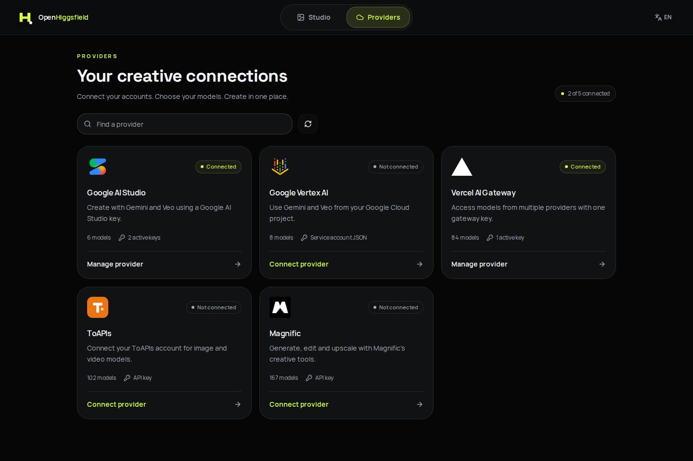
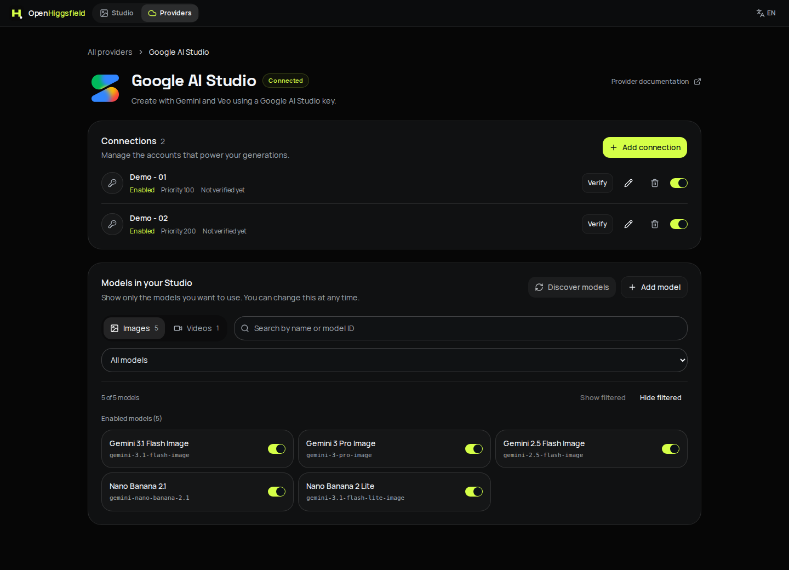
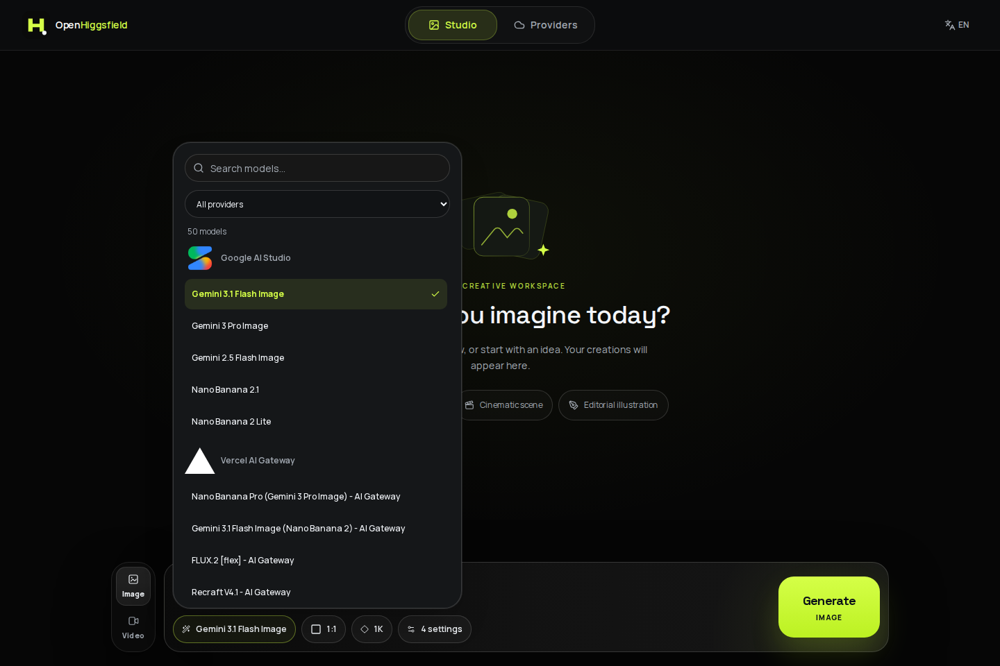
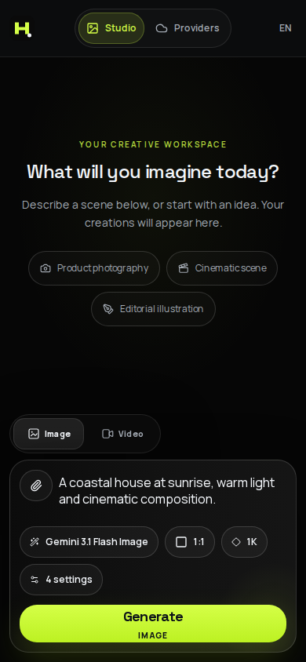
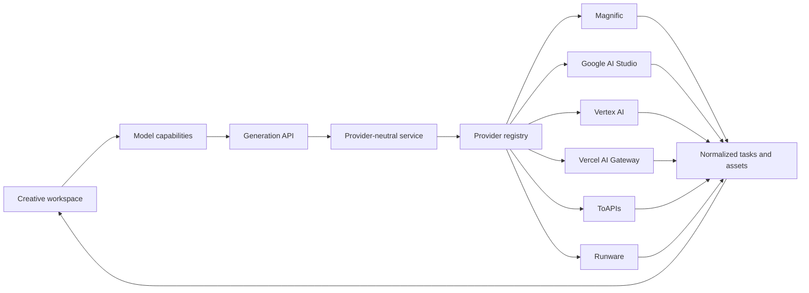

<div align="center">
  

  # Open-Higgsfield

  **The open-source, multi-provider alternative to Higgsfield for AI image and video generation.**

  Generate with Magnific, Google AI Studio, Google Vertex AI, Vercel AI Gateway, ToAPIs, and Runware models from one focused creative studio.

  <p>
    <a href="https://openhiggs.techbe.me"><strong>Live Demo</strong></a>
    |
    <a href="#why-open-higgsfield">Features</a>
    |
    <a href="#supported-providers">Providers</a>
    |
    <a href="#quick-start">Quick Start</a>
    |
    <a href="CONTRIBUTING.md">Contribute</a>
  </p>

  <p>
    <a href="https://github.com/TechBeme/open-higgsfield/actions/workflows/ci.yml"></a>
    <a href="LICENSE"></a>
    <a href="https://nextjs.org"></a>
    <a href="https://www.typescriptlang.org"></a>
    <a href="https://github.com/TechBeme/open-higgsfield/stargazers"></a>
  </p>

  **Languages:** 🇺🇸 English · [🇧🇷 Português](README.pt-BR.md) · [🇪🇸 Español](README.es.md)

  <p>
    <a href="https://vercel.com/new/clone?repository-url=https%3A%2F%2Fgithub.com%2FTechBeme%2Fopen-higgsfield"></a>
  </p>
</div>



## Why Open-Higgsfield?

AI media models are spread across providers, dashboards, payload formats, and incompatible controls. Open-Higgsfield brings them into one fast visual workspace:

- **Generate images and videos in the same studio** without switching products.
- **Choose image and video models** across Magnific, Google AI Studio, Vertex AI, Vercel AI Gateway, ToAPIs, and Runware.
- **Use the right controls for every model** with capability-driven aspect ratios, resolutions, duration, seed, CFG, safety, and audio options.
- **Work with references naturally** through image-to-image, image-to-video, start/end frames, video, and audio inputs.
- **Switch providers without relearning the interface** because tasks, progress, errors, and outputs use one consistent workflow.
- **Bring your own API keys and own the stack** with an MIT-licensed, self-hostable Next.js application.

## Screenshots

### Provider management

Connect your accounts, enable the models you want to use, and manage multiple API keys from one place. Only models from connected providers appear in the Studio.



### Connections and model selection

Each provider has its own connections, priorities, and model visibility settings. In the Studio, search by model name or ID and filter by provider.

| Provider settings | Searchable model picker |
| --- | --- |
|  |  |

### Desktop and mobile Studio

The same workspace supports image and video generation, with controls derived from each model's capabilities. Before a provider is connected, generation stays disabled and the setup action is visible.

<p align="center">
  
</p>

Captured with Playwright from the production build in an isolated workspace. The connections and prompt are demonstration data; no real API keys, private media, or paid generations were used.

## Supported providers

Connect a provider from **Providers**, or configure its environment credentials. The built-in catalog currently contains these image and video entries:

| Provider | Images | Videos | Environment credentials |
| --- | ---: | ---: | --- |
| Magnific | 50 | 117 | `MAGNIFIC_API_KEY` |
| Google AI Studio | 5 | 1 | `GEMINI_API_KEY` |
| Google Vertex AI | 4 | 4 | Google Cloud credentials |
| Vercel AI Gateway | 45 | 39 | `AI_GATEWAY_API_KEY` |
| ToAPIs | 51 | 51 | `TOAPIS_API_KEY` |
| Runware | 191 | 110 | `RUNWARE_API_KEY` |

Counts verified against `/api/catalog` on November 3, 2026. Entries include workflow variants, not just distinct upstream models. Only enabled models from connected providers appear in the Studio.

The catalog includes Gemini Image, Veo, Flux, Recraft, GPT Image, Kling, Wan, Runway, Seedance, Seedream, PixVerse, LTX, MiniMax, Z-Image, and OmniHuman. Model availability, pricing, quotas, and preview access are controlled by each upstream provider.

Runware includes all 301 live image/video models with a callable AIR in the official index (191 images and 110 videos), with schema validation and asynchronous task tracking. All are enabled by default; each installation can choose which models to display. See [Runware integration](docs/runware-models.md) for coverage and limits.

See [Providers and models](docs/providers.md) for credentials, provider behavior, and extension instructions.

## Features

- Prompt-to-image and prompt-to-video generation
- Image-to-image and image-to-video workflows
- Start frame, end frame, character, motion, video, and audio references
- Model-aware aspect ratio, size, resolution, duration, seed, CFG, style, and safety controls
- Native audio and multi-shot options where supported
- Drag-and-drop, paste, upload, and public URL inputs
- Normalized synchronous and asynchronous generation tasks
- Live progress, reusable prompts, previews, and downloads
- Responsive desktop and mobile command interface
- Interface in English, Brazilian Portuguese, and Spanish, with a persistent language selector
- Multiple encrypted connections per provider, connection priorities, model visibility controls, and model discovery where supported
- Server-only provider credentials
- Local Node.js, Docker, and Vercel deployment support

## Tech stack

[](https://nextjs.org/)
[](https://react.dev/)
[](https://www.typescriptlang.org/)
[](https://tailwindcss.com/)
[](https://vercel.com/)

- Next.js App Router and server route handlers
- React 19, strict TypeScript, Tailwind CSS 4, and Framer Motion
- Shared UI components following shadcn conventions, built on Base UI primitives
- SWR for client data and next-intl for English, Brazilian Portuguese, and Spanish
- Capability-driven model catalog and provider-neutral generation contracts
- Magnific API, Google Gen AI SDK, Vertex AI, Vercel AI Gateway, ToAPIs, and Runware
- Cloudinary handoff for workflows that require public reference-media URLs
- PostgreSQL/Neon task history, or an explicit single-process local store

## Architecture



The UI reads model capabilities instead of provider-specific rules. The backend converts every request into canonical generation parameters, resolves the provider adapter, and normalizes synchronous results or asynchronous operations into the same task format.

See [Architecture](docs/architecture.md) for the complete request lifecycle and extension points.

## Quick start

### Prerequisites

- Node.js 22.23.4 or newer within the Node 22 release line
- npm 10+
- At least one supported provider credential
- Cloudinary credentials only when a workflow requires public reference-media URLs

### 1. Clone and install

```bash
git clone https://github.com/TechBeme/open-higgsfield.git
cd open-higgsfield
npm ci
```

### 2. Configure connection encryption

```bash
cp .env.example .env.local
node -e "console.log(require('node:crypto').randomBytes(32).toString('hex'))"
```

Copy the generated value into `.env.local`:

```dotenv
PROVIDER_CONFIG_ENCRYPTION_KEY=<paste-the-generated-value>
```

This encrypts the provider credentials saved through the interface. Keep it stable across restarts and back it up separately from the stored configuration; replacing it prevents existing connections from being decrypted. Do not commit `.env.local`.

### 3. Start and connect a provider

```bash
npm run dev
```

Open [http://localhost:3000](http://localhost:3000). Use the language selector in the top bar to switch between English, Portuguese, and Spanish.

1. Open **Providers**, select a provider, and choose **Add connection**.
2. Enter a name and API key, or the service account details for Vertex AI. You can add multiple connections and set their priorities.
3. Choose which image and video models to show, then return to **Studio** and enter a prompt. Without an enabled connection and model, generation stays disabled.

**Discover models** is available for Google AI Studio, Vercel AI Gateway and Runware. Discovery saves candidates for review; it does not activate new models automatically. Custom models reuse a compatible adapter and require a reviewed capability contract. See [runtime configuration](docs/providers.md#runtime-provider-configuration).

Development binds to `127.0.0.1`. Credential-free development must remain local; use explicit credentials and an HTTPS origin before exposing another environment.

### Environment credentials (optional)

For deployments managed through environment variables, configure only the providers you use in `.env.local`:

```dotenv
# Magnific
MAGNIFIC_API_KEY=

# Google AI Studio
GEMINI_API_KEY=

# Google Vertex AI
GOOGLE_CLOUD_PROJECT=
GOOGLE_CLOUD_LOCATION=global
GOOGLE_SERVICE_ACCOUNT_JSON=

# Vercel AI Gateway
AI_GATEWAY_API_KEY=

# ToAPIs
TOAPIS_API_KEY=

# Runware
RUNWARE_API_KEY=

# Reference-media uploads
CLOUDINARY_URL=
```

Never use `NEXT_PUBLIC_` for provider credentials. Open-Higgsfield reads them only from server-side modules.

Saved connections take precedence over environment credentials. If you disable every saved connection for a provider, its models disappear from the Studio even if an environment key exists.

### Docker

Reuse the `.env.local` file configured above and complete the production setup before starting the container.

```bash
docker compose up --build
```

Configure the production access and single-process profile from the [operator guide](docs/production.md) before starting Docker. It stores files and history in the `open-higgsfield-data` volume and publishes port 3000 on loopback for an HTTPS reverse proxy.

## Deploy on Vercel

Production requires an operator credential, an HTTPS origin, migrated PostgreSQL task storage, explicitly public Cloudinary outputs and recurring execution. The included minute cron requires **Vercel Pro or Enterprise**. New generation stays disabled until `GENERATION_ENABLED=true` is explicitly configured.

Each deployment is one operator-owned BYOK workspace. There are no per-user
ownership boundaries, application monetary budgets or global rate limits; if the
operator shares the URL, every visitor uses that deployment's credentials and
quota. Configure provider quotas/budgets and ingress controls before enabling
work. Cloudinary media remains public by URL.

Follow the [production operator guide](docs/production.md) for configuration, migration, scheduler verification and rollback before deploying.

## Commands

| Command | Purpose |
| --- | --- |
| `npm run dev` | Start the development server |
| `npm run lint` | Run ESLint |
| `npm run typecheck` | Run TypeScript checks |
| `npm test` | Run unit and integration regressions |
| `npm run test:e2e` | Run isolated browser and accessibility tests |
| `npm run build` | Create a production build |
| `npm run check` | Run dependency audit, lint, typecheck, tests, build, and browser tests |
| `npm start` | Serve the production build |

Browser-test setup and isolation details: [Verification](docs/architecture.md#verification).

## Documentation

- [Providers and models](docs/providers.md): credentials, supported integrations, and adding providers
- [Architecture](docs/architecture.md): capability system, provider registry, tasks, and storage
- [Deployment](docs/deployment.md): Vercel, Docker, Node.js, security, and persistence
- [Contributing](CONTRIBUTING.md): development workflow and pull requests
- [Security policy](SECURITY.md): responsible vulnerability reporting

## Contributing

Contributions are welcome, from new providers and model families to accessibility, translations, tests, and creative tooling.

1. Read [CONTRIBUTING.md](CONTRIBUTING.md).
2. Fork the repository and create a focused branch.
3. Run `npm run check`.
4. Open a pull request using the provided template.

If Open-Higgsfield is useful to you, **star the repository**, share it with another creator, and show us what you build.

## Security

Do not report vulnerabilities in public issues. Follow [SECURITY.md](SECURITY.md) and never include provider credentials, private generated media, or personal data in reports.

## Disclaimer

Open-Higgsfield is an independent open-source project. It is not affiliated with, endorsed by, or sponsored by Higgsfield AI, Magnific, Google, Vercel, or any model provider. Product and model names belong to their respective owners. Availability, pricing, quotas, APIs, and capabilities may change upstream.

You are responsible for provider costs, generated content, deployment security, and compliance with provider terms and applicable law.

## License

Released under the [MIT License](LICENSE).

---

<div align="center">

**Developed by [Rafael Vieira](https://github.com/TechBeme)**

[](https://github.com/TechBeme)
[](https://www.fiverr.com/tech_be)
[](https://www.upwork.com/freelancers/~01f0abcf70bbd95376)
[](mailto:contact@techbe.me)

</div>
