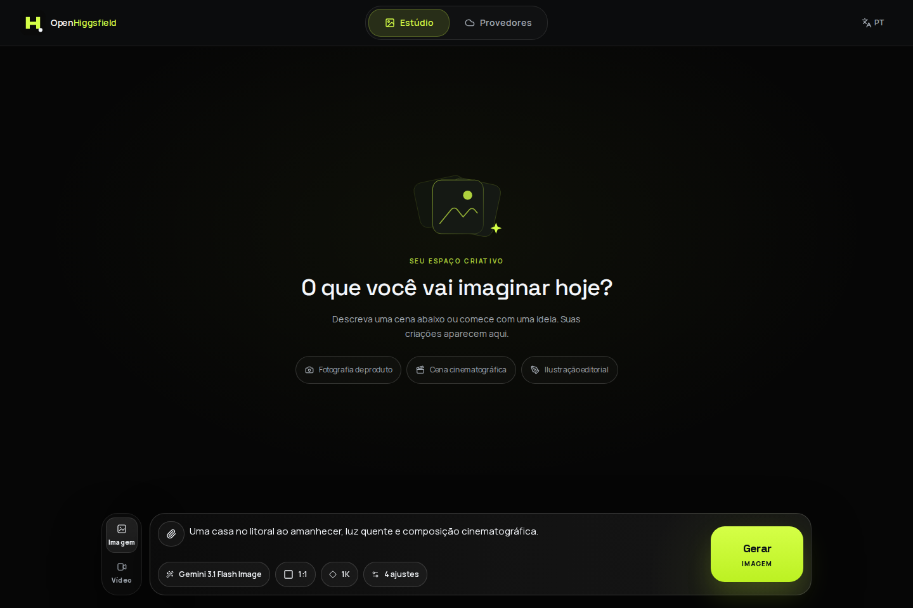
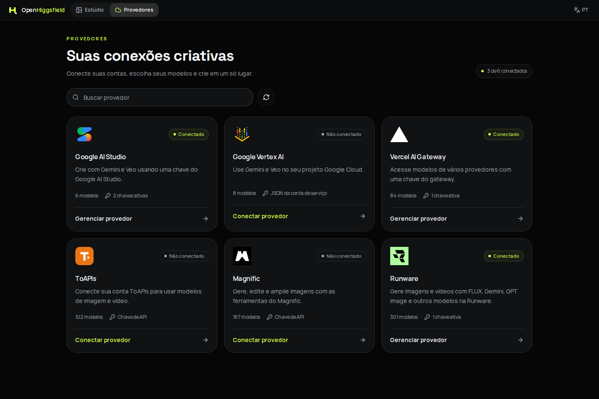
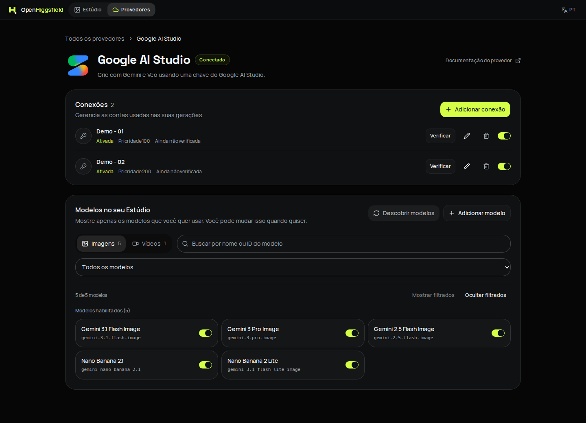
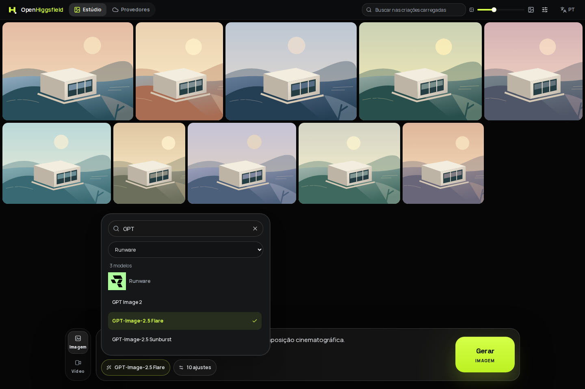
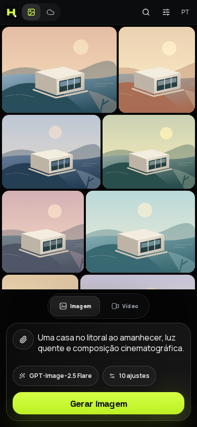
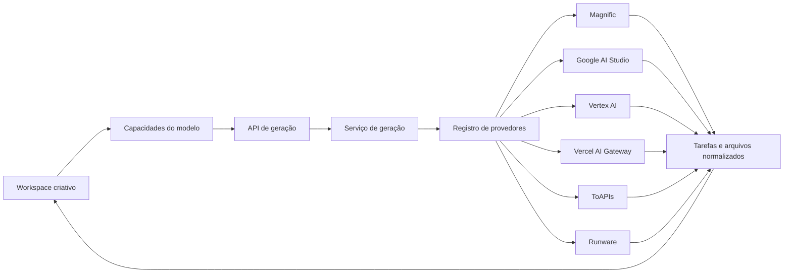

<div align="center">
  

  # Open-Higgsfield

  **A alternativa open source e multiprovedor ao Higgsfield para gerar imagens e vídeos com IA.**

  Gere com modelos da Magnific, Google AI Studio, Google Vertex AI, Vercel AI Gateway, ToAPIs e Runware em um único estúdio criativo.

  <p>
    <a href="https://openhiggs.techbe.me"><strong>Demo ao vivo</strong></a>
    |
    <a href="#por-que-open-higgsfield">Recursos</a>
    |
    <a href="#provedores-suportados">Provedores</a>
    |
    <a href="#início-rápido">Início rápido</a>
    |
    <a href="CONTRIBUTING.md">Contribuir</a>
  </p>

  <p>
    <a href="https://github.com/TechBeme/open-higgsfield/actions/workflows/ci.yml"></a>
    <a href="LICENSE"></a>
    <a href="https://nextjs.org"></a>
    <a href="https://www.typescriptlang.org"></a>
    <a href="https://github.com/TechBeme/open-higgsfield/stargazers"></a>
  </p>

  **Idiomas:** [🇺🇸 English](README.md) · 🇧🇷 Português · [🇪🇸 Español](README.es.md)

  <p>
    <a href="https://vercel.com/new/clone?repository-url=https%3A%2F%2Fgithub.com%2FTechBeme%2Fopen-higgsfield"></a>
  </p>
</div>



## Por que Open-Higgsfield?

Modelos de mídia generativa estão espalhados entre provedores, painéis e controles incompatíveis. O Open-Higgsfield reúne tudo em um único workspace visual:

- **Gere imagens e vídeos no mesmo estúdio** sem trocar de produto.
- **Escolha modelos de imagem e vídeo** da Magnific, Google AI Studio, Vertex AI, Vercel AI Gateway, ToAPIs e Runware.
- **Use os controles certos para cada modelo**: proporção, resolução, duração, seed, CFG, segurança e áudio.
- **Trabalhe com referências naturalmente** em fluxos image-to-image, image-to-video, primeiro/último frame, vídeo e áudio.
- **Troque de provedor sem reaprender a interface** com tarefas, progresso, erros e resultados normalizados.
- **Use suas próprias chaves e controle a stack** com uma aplicação Next.js MIT e self-hostable.

## Capturas de tela

### Gerenciamento de provedores

Conecte suas contas, ative os modelos que deseja usar e gerencie várias chaves de API no mesmo lugar. Somente modelos de provedores conectados aparecem no Estúdio.



### Conexões e seleção de modelos

Cada provedor tem suas próprias conexões, prioridades e configurações de visibilidade dos modelos. No Estúdio, busque pelo nome ou ID do modelo e filtre por provedor.

| Configurações do provedor | Seletor de modelos com busca |
| --- | --- |
|  |  |

### Estúdio no desktop e no celular

O mesmo workspace permite gerar imagens e vídeos, com controles derivados das capacidades de cada modelo. Antes de conectar um provedor, a geração fica desabilitada e a ação de configuração fica visível.

<p align="center">
  
</p>

Capturas feitas com Playwright no build de produção, em um workspace isolado. As conexões e o prompt são demonstrativos; nenhuma chave real, mídia privada ou geração paga foi usada.

## Provedores suportados

Conecte um provedor em **Provedores** ou configure suas credenciais por variáveis de ambiente. O catálogo integrado contém as seguintes entradas de imagem e vídeo:

| Provedor | Imagens | Vídeos | Credenciais de ambiente |
| --- | ---: | ---: | --- |
| Magnific | 50 | 117 | `MAGNIFIC_API_KEY` |
| Google AI Studio | 5 | 1 | `GEMINI_API_KEY` |
| Google Vertex AI | 4 | 4 | Credenciais do Google Cloud |
| Vercel AI Gateway | 45 | 39 | `AI_GATEWAY_API_KEY` |
| ToAPIs | 51 | 51 | `TOAPIS_API_KEY` |
| Runware | 191 | 110 | `RUNWARE_API_KEY` |

Contagens verificadas em `/api/catalog` em 3 de novembro de 2026. As entradas incluem variantes de uso, não apenas modelos distintos do provedor. Somente modelos habilitados de provedores conectados aparecem no Estúdio.

O catálogo inclui Gemini Image, Veo, Flux, Recraft, GPT Image, Kling, Wan, Runway, Seedance, Seedream, PixVerse, LTX, MiniMax, Z-Image e OmniHuman. Disponibilidade, preço, cotas e acesso preview são controlados por cada provedor.

A Runware inclui os 301 modelos de imagem/vídeo ativos com AIR no índice oficial (191 de imagem e 110 de vídeo), com validação de parâmetros e acompanhamento assíncrono. Todos vêm habilitados por padrão; cada instalação escolhe quais mostrar. Veja a [integração Runware](docs/runware-models.md) para cobertura e limites.

Veja [Provedores e modelos](docs/providers.md) para credenciais e instruções de extensão.

## Recursos

- Geração prompt-to-image e prompt-to-video
- Fluxos image-to-image e image-to-video
- Referências de primeiro frame, último frame, personagem, movimento, vídeo e áudio
- Controles de proporção, tamanho, resolução, duração, seed, CFG, estilo e segurança por modelo
- Áudio nativo e múltiplas cenas quando suportados
- Entradas por arrastar e soltar, colar, upload e URL pública
- Tarefas síncronas e assíncronas normalizadas
- Progresso ao vivo, reutilização de prompts, preview e download
- Interface responsiva para desktop e mobile
- Interface em inglês, português brasileiro e espanhol, com seletor de idioma persistente
- Várias conexões criptografadas por provedor, prioridades, controle de modelos visíveis e descoberta de modelos quando disponível
- Credenciais disponíveis somente no servidor
- Deploy local, Docker e Vercel

## Stack técnica

[](https://nextjs.org/)
[](https://react.dev/)
[](https://www.typescriptlang.org/)
[](https://tailwindcss.com/)
[](https://vercel.com/)

- Next.js App Router e rotas de API no servidor
- React 19, TypeScript strict, Tailwind CSS 4 e Framer Motion
- Componentes compartilhados seguindo as convenções do shadcn, com primitivas do Base UI
- SWR para dados no cliente e next-intl para inglês, português brasileiro e espanhol
- Catálogo de capacidades e contratos de geração comuns aos provedores
- Magnific API, Google Gen AI SDK, Vertex AI, Vercel AI Gateway, ToAPIs e Runware
- Cloudinary para fluxos que exigem URLs públicas de mídia
- Histórico em PostgreSQL/Neon ou armazenamento local explícito com um único processo

## Arquitetura



A interface lê as capacidades dos modelos. O backend converte cada solicitação em parâmetros canônicos, resolve o adaptador e normaliza resultados síncronos ou operações assíncronas no mesmo formato de tarefa. Veja [Arquitetura](docs/architecture.md).

## Início rápido

### Pré-requisitos

- Node.js 22.23.4 ou mais recente dentro da linha Node 22
- npm 10+
- Credencial de pelo menos um provedor
- Cloudinary apenas para fluxos que exigem URLs públicas de referência

### 1. Clone e instale

```bash
git clone https://github.com/TechBeme/open-higgsfield.git
cd open-higgsfield
npm ci
```

### 2. Configure a criptografia das conexões

```bash
cp .env.example .env.local
node -e "console.log(require('node:crypto').randomBytes(32).toString('hex'))"
```

Copie o valor gerado para `.env.local`:

```dotenv
PROVIDER_CONFIG_ENCRYPTION_KEY=<cole-o-valor-gerado>
```

Essa chave criptografa as credenciais salvas pela interface. Mantenha o mesmo valor entre reinicializações e guarde um backup separado da configuração; trocá-lo impede a leitura das conexões existentes. Não envie `.env.local` para o Git.

### 3. Inicie e conecte um provedor

```bash
npm run dev
```

Abra [http://localhost:3000](http://localhost:3000). Use o seletor na barra superior para alternar entre inglês, português e espanhol.

1. Abra **Provedores**, selecione um provedor e clique em **Adicionar conexão**.
2. Informe um nome e a chave de API, ou os dados da conta de serviço do Vertex AI. Você pode adicionar várias conexões e definir suas prioridades.
3. Escolha os modelos de imagem e vídeo que deseja mostrar, volte ao **Estúdio** e escreva seu prompt. Sem uma conexão e um modelo habilitados, a geração fica desativada.

**Descobrir modelos** está disponível para Google AI Studio, Vercel AI Gateway e Runware. A descoberta salva candidatos para revisão, sem ativá-los automaticamente. Modelos personalizados reutilizam um adaptador compatível e precisam de um contrato de capacidades revisado. Veja [configuração de provedores](docs/providers.md#runtime-provider-configuration).

O desenvolvimento escuta em `127.0.0.1`. Sem credenciais, mantenha o servidor local; configure senha e origem HTTPS antes de expor outro ambiente.

### Credenciais por ambiente (opcional)

Para instalações gerenciadas por variáveis de ambiente, configure em `.env.local` apenas os provedores que deseja usar:

```dotenv
MAGNIFIC_API_KEY=
GEMINI_API_KEY=
GOOGLE_CLOUD_PROJECT=
GOOGLE_CLOUD_LOCATION=global
GOOGLE_SERVICE_ACCOUNT_JSON=
AI_GATEWAY_API_KEY=
TOAPIS_API_KEY=
RUNWARE_API_KEY=
CLOUDINARY_URL=
```

Nunca use `NEXT_PUBLIC_` em credenciais de provedores. Elas são lidas somente no servidor.

As conexões salvas têm prioridade sobre as credenciais de ambiente. Ao desativar todas as conexões salvas de um provedor, seus modelos deixam de aparecer no Estúdio mesmo que exista uma chave no ambiente.

### Docker

Reutilize o arquivo `.env.local` já configurado e complete a configuração de produção antes de iniciar o contêiner.

```bash
docker compose up --build
```

Configure o acesso de produção e o perfil de processo único no [guia de operação](docs/production.md) antes de iniciar o Docker. Arquivos e histórico ficam no volume `open-higgsfield-data`; a porta 3000 é publicada somente em loopback para um proxy reverso HTTPS.

## Deploy na Vercel

Produção exige credencial do operador, origem HTTPS, PostgreSQL migrado, mídia pública no Cloudinary e execução recorrente. O cron por minuto incluído exige **Vercel Pro ou Enterprise**. Novas gerações ficam desativadas até configurar `GENERATION_ENABLED=true`.

Cada deploy é um workspace BYOK de um operador: quem tem a credencial acessa todas as tarefas e usa as mesmas contas dos provedores. Não há isolamento por usuário, orçamento monetário ou limite global de requisições no aplicativo. Configure cotas dos provedores e proteção na entrada. Arquivos do Cloudinary continuam públicos por URL.

Siga o [guia de operação](docs/production.md) antes de iniciar Docker ou publicar na Vercel; ele descreve configuração, migração, HTTPS, agendamento e recuperação.

## Comandos

| Comando | Finalidade |
| --- | --- |
| `npm run dev` | Inicia o servidor de desenvolvimento |
| `npm run lint` | Executa o ESLint |
| `npm run typecheck` | Verifica o TypeScript |
| `npm test` | Executa testes de unidade e integração |
| `npm run test:e2e` | Executa testes isolados de navegador e acessibilidade |
| `npm run build` | Cria o build de produção |
| `npm run check` | Executa auditoria, lint, typecheck, testes, build e testes de navegador |
| `npm start` | Serve o build de produção |

Configuração e isolamento dos testes de navegador: [Verificação](docs/architecture.md#verification).

## Documentação

- [Provedores e modelos](docs/providers.md)
- [Arquitetura](docs/architecture.md)
- [Deploy](docs/deployment.md)
- [Como contribuir](CONTRIBUTING.md)
- [Política de segurança](SECURITY.md)

## Como contribuir

Leia [CONTRIBUTING.md](CONTRIBUTING.md), crie uma branch focada, execute `npm run check` e abra um pull request. Se o projeto for útil, **dê uma estrela no repositório** e compartilhe o que você construiu.

## Segurança e aviso legal

Não relate vulnerabilidades em issues públicas. Open-Higgsfield é independente e não é afiliado à Higgsfield AI, Magnific, Google, Vercel ou provedores de modelos. Você é responsável por custos, conteúdo gerado, segurança e conformidade.

## Licença

Distribuído sob a [Licença MIT](LICENSE).

---

<div align="center">

**Developed by [Rafael Vieira](https://github.com/TechBeme)**

[](https://github.com/TechBeme)
[](https://www.fiverr.com/tech_be)
[](https://www.upwork.com/freelancers/~01f0abcf70bbd95376)
[](mailto:contact@techbe.me)

</div>
